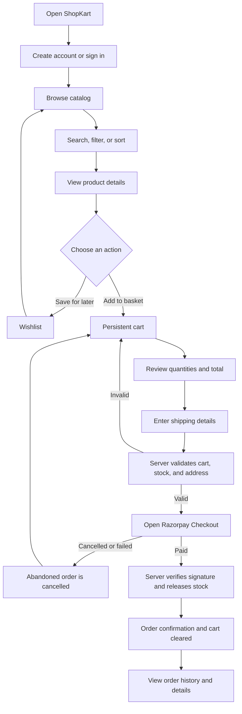
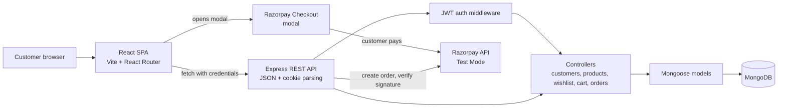

# ShopKart


**A full-stack shopping experience built with the MERN stack.**

ShopKart brings together a React storefront and an Express API to let customers browse a MongoDB-backed product catalog, save products, manage a persistent cart, and pay for orders through the Razorpay payment gateway.

> **🔐 Secure checkout:** ShopKart payments are handled by the **Razorpay payment gateway** using Razorpay Standard Checkout. The ShopKart server verifies Razorpay's payment signature before confirming an order. This project is configured for **Test Mode only**.

> **Project status:** This is a customer-facing shopping application. Checkout runs against **Razorpay Test Mode** only — no real money moves, and the server rejects live keys. There is no admin dashboard.

<details>
<summary>🧭 Jump to a section</summary>

- [At a glance](#at-a-glance)
- [What customers can do](#what-customers-can-do)
- [User journey](#user-journey)
- [Architecture](#architecture)
- [Getting started](#getting-started)
- [Razorpay Test Mode keys](#razorpay-test-mode-keys)
- [API overview](#api-overview)
- [Data model](#data-model)
- [Available scripts](#available-scripts)
- [Current scope and notes](#current-scope-and-notes)

</details>

## At a glance

| Area | Technology |
| --- | --- |
| Frontend | React 19, React Router, Vite, Tailwind CSS |
| Backend | Node.js, Express |
| Database and models | MongoDB, Mongoose |
| Payments | Razorpay Checkout (Test Mode), verified server-side with HMAC-SHA256 |
| Authentication | JWT in an HTTP-only cookie; bcrypt password hashing |
| API communication | JSON over HTTP, with credentials included |

## What customers can do

- Create an account, sign in, sign out, and change their password.
- Browse the catalog, search by product name, filter by category, and sort by price.
- Open product details and see current price and stock.
- Save products to a personal wishlist.
- Add products to a persistent cart, change quantities, and remove items.
- Enter a shipping address and pay for an order through Razorpay Checkout.
- Review previous orders, their status, delivery address, and item-price snapshots.

## User journey



1. **Sign up or sign in.** A new customer registers with their name, email, phone number, and password. After signing in, the API issues a JWT in an HTTP-only cookie. Protected pages check the session with the backend.
2. **Explore the catalog.** Customers can search, filter by category, sort by price, and open a product's detail page. Catalog filters are reflected in the URL, so a filtered view can be refreshed or shared.
3. **Save or add products.** Wishlist entries and cart quantities are stored on the customer's MongoDB document. The cart is loaded from the API, so it remains available after a refresh or a later sign-in.
4. **Review the cart.** The API checks product existence and available stock when cart items or quantities change. The frontend displays the cart summary and quantity controls.
5. **Pay with Razorpay.** The customer supplies a shipping address. The server re-reads the cart and current product records, validates stock and address details, then calculates the amount itself — item prices from the product documents, plus 18% GST — and stores a snapshot of the purchased items against a pending order. Razorpay Checkout opens for that exact amount, so the figure charged is always the figure the cart and checkout pages showed.
6. **Get a verified order.** When the payment succeeds, the browser sends Razorpay's payment id and signature back to the server, which recomputes the HMAC-SHA256 signature from its own secret. Only a matching signature marks the order paid, releases stock, and clears the cart; a tampered or missing signature is rejected. Closing the modal or a failed payment cancels the pending order instead, so abandoned attempts never reach the order history. The customer then sees a confirmation and can view their order history and individual order details — orders are scoped to the signed-in customer.

## Architecture



The project is **MERN** because its application stack uses **MongoDB** for data, **Express** and **Node.js** for the server/API, and **React** for the browser interface. Mongoose defines and queries MongoDB documents. Vite and Tailwind CSS support frontend development and styling; they complement the MERN stack rather than replace any of its core parts.

### Request and data flow

- The React application calls the API through a shared client in `frontend/src/services/api.js`. API calls include browser credentials so the authentication cookie is sent.
- Express parses JSON and cookies, configures credentialed CORS for the frontend origin, and mounts the customer, product, wishlist, cart, and order routers.
- Protected routers use authentication middleware to verify the JWT and load the current customer. Customer-specific operations use that authenticated customer rather than trusting an ID supplied by the browser.
- Controllers handle validation and application rules, then read or update Mongoose models.
- Mongoose persists customers, products, and orders in MongoDB. Cart and wishlist data are stored as references on customer documents; order items keep name, price, and image snapshots so later product edits do not rewrite past orders.
- The cart context shares server-returned cart state across React pages and derives item counts and displayed totals from it.
- Payment amounts are never taken from the browser. The server prices the order from its own product records, creates the matching Razorpay order, and only marks an order paid when the returned signature matches one it computes itself with the Razorpay key secret.

### Repository layout

```text
shopkart/
├── config/
│   └── db.js                    # MongoDB connection
├── controllers/                 # Request handlers and business rules
├── middlewares/
│   └── auth.middleware.js       # JWT cookie verification
├── models/                      # Customer, Product, and Order schemas
├── routes/                      # Express API route definitions
├── utils/
│   ├── generateToken.js         # JWT creation
│   └── seedProducts.js          # Sample catalog seeder
├── frontend/
│   ├── src/
│   │   ├── components/          # Shared UI and protected-route handling
│   │   ├── context/             # Shared cart state
│   │   ├── pages/               # Storefront, account, cart, and order pages
│   │   └── services/api.js      # Frontend API client
│   └── package.json
├── .env.example
├── index.js                     # Express app and server startup
└── package.json                 # Backend scripts and dependencies
```

## Getting started

### Prerequisites

- Node.js and npm
- A MongoDB database, such as a MongoDB Atlas cluster or a local MongoDB server

### 1. Configure the backend

From the repository root, install the backend dependencies and create your local environment file:

```bash
npm install
cp .env.example .env
```

On Windows PowerShell, use `Copy-Item .env.example .env` instead of `cp`.

Set the values in `.env`:

| Variable | Purpose |
| --- | --- |
| `PORT` | API port; defaults to `5000` |
| `MONGO_URI` | MongoDB connection string |
| `jwt_secret` | A long, random secret used to sign JWTs |
| `FRONTEND_URL` | Allowed frontend origin; defaults to `http://localhost:5173` |
| `RAZORPAY_KEY_ID` | Razorpay **Test Mode** key id; must begin with `rzp_test_` |
| `RAZORPAY_KEY_SECRET` | The matching Test Mode key secret |

Keep `.env` private and do not commit it. The example file contains placeholders, not working credentials.

#### Razorpay Test Mode keys

Checkout needs a pair of Test Mode keys before it will accept a payment:

1. Sign in at [dashboard.razorpay.com](https://dashboard.razorpay.com) and make sure the dashboard is in **Test Mode** (the toggle is in the top bar).
2. Open **Account & Settings → API Keys** and generate a test key.
3. Copy the key id (it starts with `rzp_test_`) and its secret into `RAZORPAY_KEY_ID` and `RAZORPAY_KEY_SECRET`.

The key secret stays on the server and is never sent to the browser — only the key id is, since Razorpay Checkout needs it. The server refuses to start a payment unless the key id begins with `rzp_test_`, so live keys are rejected by design.

To pay with a test card, use `4111 1111 1111 1111` with any future expiry date, any CVV, and the test OTP the modal offers.

### 2. Configure the frontend

In a second terminal:

```bash
cd frontend
npm install
```

The frontend defaults to `http://localhost:5000` for its API. To use another API URL, create `frontend/.env` and set:

```env
VITE_API_URL=http://localhost:5000
```

### 3. Start the application

Run these in separate terminals:

```bash
# Repository root: start the API with automatic reload
npm run dev
```

```bash
# frontend/: start the Vite development server
npm run dev
```

Open [http://localhost:5173](http://localhost:5173). The API listens on port `5000` by default.

### 4. Add sample products (optional)

From the repository root:

```bash
npm run seed
```

> **Important:** Seeding deletes all documents in the MongoDB `Product` collection before inserting the sample catalog. It does not delete customer or order documents. Only run it against a database where replacing the product catalog is acceptable.

## API overview

All routes are mounted on the backend origin. Routes marked **Protected** require a valid JWT cookie.

| Base path | Method and route | Access | Purpose |
| --- | --- | --- | --- |
| `/customers` | `POST /register` | Public | Create a customer account |
| `/customers` | `POST /login` | Public | Sign in and set the auth cookie |
| `/customers` | `GET /me` | Protected | Return the signed-in customer |
| `/customers` | `POST /logout` | Protected | Clear the auth cookie |
| `/customers` | `PATCH /change-password` | Protected | Change the account password |
| `/products` | `GET /` | Public API | List products; supports `search`, `category`, and `sort` query parameters |
| `/products` | `GET /:id` | Public API | Get product details |
| `/products` | `POST /` | Public API | Create a product |
| `/wishlist` | `GET /` | Protected | Get the customer's wishlist |
| `/wishlist` | `POST /:productId` | Protected | Add a product to the wishlist |
| `/wishlist` | `DELETE /:productId` | Protected | Remove a product from the wishlist |
| `/wishlist` | `PATCH /:productId/toggle` | Protected | Toggle wishlist membership |
| `/cart` | `GET /` | Protected | Get the customer's cart |
| `/cart` | `POST /:productId` | Protected | Add one unit of a product |
| `/cart` | `PATCH /:productId` | Protected | Set a cart item's quantity |
| `/cart` | `DELETE /:productId` | Protected | Remove a cart item |
| `/orders` | `POST /create-payment-order` | Protected | Price the cart, create a pending order, and open a matching Razorpay order |
| `/orders` | `POST /verify-payment` | Protected | Verify the payment signature, mark the order paid, release stock, clear the cart |
| `/orders` | `POST /:id/cancel-payment` | Protected | Mark a pending order abandoned when checkout is closed or fails |
| `/orders` | `GET /` | Protected | List the customer's paid orders |
| `/orders` | `GET /:id` | Protected | Get one of the customer's orders |

The product-creation endpoint is currently unauthenticated; there is no admin role or admin dashboard in this project.

## Data model

- **Customer:** account details and password hash, plus product ObjectId references for the wishlist and product/quantity entries for the cart.
- **Product:** name, description, price, category, image URL, and stock count.
- **Order:** customer reference, shipping address, item snapshots, server-calculated subtotal, GST and total, Razorpay order and payment ids, payment method/status, and order status.

## Available scripts

| Directory | Command | Description |
| --- | --- | --- |
| Repository root | `npm run dev` | Start the backend with nodemon |
| Repository root | `npm start` | Start the backend |
| Repository root | `npm run seed` | Replace the product collection with sample products |
| `frontend/` | `npm run dev` | Start the Vite development server |
| `frontend/` | `npm run build` | Build the frontend for production |
| `frontend/` | `npm run preview` | Preview the built frontend locally |

## Current scope and notes

- Checkout runs against **Razorpay Test Mode** only. The server rejects any key id that does not begin with `rzp_test_`, so the flow can never charge a real card as configured.
- Payment confirmation relies on the browser returning the payment id and signature, which the server verifies with HMAC-SHA256 before marking the order paid. There is no Razorpay webhook, so a customer who closes the tab mid-payment leaves an order the server never hears about; it stays pending and is excluded from their order history.
- Orders that are abandoned or whose payment fails are marked `CANCELLED` rather than deleted, and are filtered out of `GET /orders`. They remain reachable by id.
- GST is 18% and is computed on the server from its own product prices, then stored on the order. The cart, checkout and receipt pages all display that same subtotal / GST / total breakdown.
- Product creation is available through the API but is not an admin-only operation.
- The product seeder uses sample records and image URLs from `picsum.photos`.
