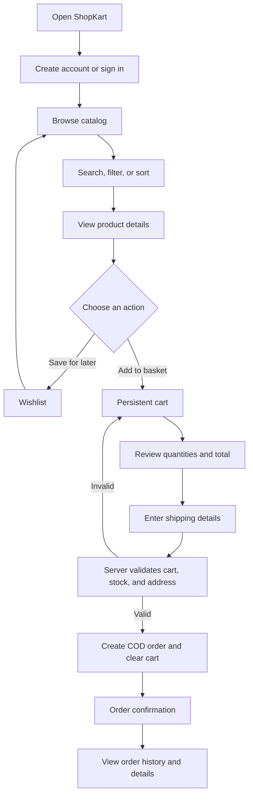
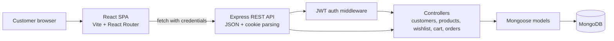

# ShopKart

**A full-stack shopping experience built with the MERN stack.**

ShopKart brings together a React storefront and an Express API to let customers browse a MongoDB-backed product catalog, save products, manage a persistent cart, and place cash-on-delivery orders.

> **Project status:** This is a customer-facing shopping application. Checkout currently supports **cash on delivery (COD)** only; there is no online payment gateway or admin dashboard.

## At a glance

| Area | Technology |
| --- | --- |
| Frontend | React 19, React Router, Vite, Tailwind CSS |
| Backend | Node.js, Express |
| Database and models | MongoDB, Mongoose |
| Authentication | JWT in an HTTP-only cookie; bcrypt password hashing |
| API communication | JSON over HTTP, with credentials included |

## What customers can do

- Create an account, sign in, sign out, and change their password.
- Browse the catalog, search by product name, filter by category, and sort by price.
- Open product details and see current price and stock.
- Save products to a personal wishlist.
- Add products to a persistent cart, change quantities, and remove items.
- Enter a shipping address and place an order using cash on delivery.
- Review previous orders, their status, delivery address, and item-price snapshots.

## User journey



1. **Sign up or sign in.** A new customer registers with their name, email, phone number, and password. After signing in, the API issues a JWT in an HTTP-only cookie. Protected pages check the session with the backend.
2. **Explore the catalog.** Customers can search, filter by category, sort by price, and open a product's detail page. Catalog filters are reflected in the URL, so a filtered view can be refreshed or shared.
3. **Save or add products.** Wishlist entries and cart quantities are stored on the customer's MongoDB document. The cart is loaded from the API, so it remains available after a refresh or a later sign-in.
4. **Review the cart.** The API checks product existence and available stock when cart items or quantities change. The frontend displays the cart summary and quantity controls.
5. **Check out with COD.** The customer supplies a shipping address. The server re-reads the cart and current product records, validates stock and address details, calculates the order amount, stores a snapshot of the purchased items, then clears the cart after the order has been created.
6. **Track the order.** The customer sees a confirmation and can later view their order history and individual order details. Orders are scoped to the signed-in customer.

## Architecture



The project is **MERN** because its application stack uses **MongoDB** for data, **Express** and **Node.js** for the server/API, and **React** for the browser interface. Mongoose defines and queries MongoDB documents. Vite and Tailwind CSS support frontend development and styling; they complement the MERN stack rather than replace any of its core parts.

### Request and data flow

- The React application calls the API through a shared client in `frontend/src/services/api.js`. API calls include browser credentials so the authentication cookie is sent.
- Express parses JSON and cookies, configures credentialed CORS for the frontend origin, and mounts the customer, product, wishlist, cart, and order routers.
- Protected routers use authentication middleware to verify the JWT and load the current customer. Customer-specific operations use that authenticated customer rather than trusting an ID supplied by the browser.
- Controllers handle validation and application rules, then read or update Mongoose models.
- Mongoose persists customers, products, and orders in MongoDB. Cart and wishlist data are stored as references on customer documents; order items keep name, price, and image snapshots so later product edits do not rewrite past orders.
- The cart context shares server-returned cart state across React pages and derives item counts and displayed totals from it.

### Repository layout

```text
shopkart/
├── config/
│   └── db.js                    # MongoDB connection
├── controllers/                 # Request handlers and business rules
├── middlewares/
│   └── auth.middleware.js       # JWT cookie verification
├── models/                      # Customer, Product, and Order schemas
├── routes/                      # Express API route definitions
├── utils/
│   ├── generateToken.js         # JWT creation
│   └── seedProducts.js          # Sample catalog seeder
├── frontend/
│   ├── src/
│   │   ├── components/          # Shared UI and protected-route handling
│   │   ├── context/             # Shared cart state
│   │   ├── pages/               # Storefront, account, cart, and order pages
│   │   └── services/api.js      # Frontend API client
│   └── package.json
├── .env.example
├── index.js                     # Express app and server startup
└── package.json                 # Backend scripts and dependencies
```

## Getting started

### Prerequisites

- Node.js and npm
- A MongoDB database, such as a MongoDB Atlas cluster or a local MongoDB server

### 1. Configure the backend

From the repository root, install the backend dependencies and create your local environment file:

```bash
npm install
cp .env.example .env
```

On Windows PowerShell, use `Copy-Item .env.example .env` instead of `cp`.

Set the values in `.env`:

| Variable | Purpose |
| --- | --- |
| `PORT` | API port; defaults to `5000` |
| `MONGO_URI` | MongoDB connection string |
| `jwt_secret` | A long, random secret used to sign JWTs |
| `FRONTEND_URL` | Allowed frontend origin; defaults to `http://localhost:5173` |

Keep `.env` private and do not commit it. The example file contains placeholders, not working credentials.

### 2. Configure the frontend

In a second terminal:

```bash
cd frontend
npm install
```

The frontend defaults to `http://localhost:5000` for its API. To use another API URL, create `frontend/.env` and set:

```env
VITE_API_URL=http://localhost:5000
```

### 3. Start the application

Run these in separate terminals:

```bash
# Repository root: start the API with automatic reload
npm run dev
```

```bash
# frontend/: start the Vite development server
npm run dev
```

Open [http://localhost:5173](http://localhost:5173). The API listens on port `5000` by default.

### 4. Add sample products (optional)

From the repository root:

```bash
npm run seed
```

> **Important:** Seeding deletes all documents in the MongoDB `Product` collection before inserting the sample catalog. It does not delete customer or order documents. Only run it against a database where replacing the product catalog is acceptable.

## API overview

All routes are mounted on the backend origin. Routes marked **Protected** require a valid JWT cookie.

| Base path | Method and route | Access | Purpose |
| --- | --- | --- | --- |
| `/customers` | `POST /register` | Public | Create a customer account |
| `/customers` | `POST /login` | Public | Sign in and set the auth cookie |
| `/customers` | `GET /me` | Protected | Return the signed-in customer |
| `/customers` | `POST /logout` | Protected | Clear the auth cookie |
| `/customers` | `PATCH /change-password` | Protected | Change the account password |
| `/products` | `GET /` | Public API | List products; supports `search`, `category`, and `sort` query parameters |
| `/products` | `GET /:id` | Public API | Get product details |
| `/products` | `POST /` | Public API | Create a product |
| `/wishlist` | `GET /` | Protected | Get the customer's wishlist |
| `/wishlist` | `POST /:productId` | Protected | Add a product to the wishlist |
| `/wishlist` | `DELETE /:productId` | Protected | Remove a product from the wishlist |
| `/wishlist` | `PATCH /:productId/toggle` | Protected | Toggle wishlist membership |
| `/cart` | `GET /` | Protected | Get the customer's cart |
| `/cart` | `POST /:productId` | Protected | Add one unit of a product |
| `/cart` | `PATCH /:productId` | Protected | Set a cart item's quantity |
| `/cart` | `DELETE /:productId` | Protected | Remove a cart item |
| `/orders` | `POST /create-payment-order` | Protected | Create a COD order from the cart and shipping address |
| `/orders` | `GET /` | Protected | List the customer's orders |
| `/orders` | `GET /:id` | Protected | Get one of the customer's orders |

The product-creation endpoint is currently unauthenticated; there is no admin role or admin dashboard in this project.

## Data model

- **Customer:** account details and password hash, plus product ObjectId references for the wishlist and product/quantity entries for the cart.
- **Product:** name, description, price, category, image URL, and stock count.
- **Order:** customer reference, shipping address, item snapshots, server-calculated total, payment method/status, and order status.

## Available scripts

| Directory | Command | Description |
| --- | --- | --- |
| Repository root | `npm run dev` | Start the backend with nodemon |
| Repository root | `npm start` | Start the backend |
| Repository root | `npm run seed` | Replace the product collection with sample products |
| `frontend/` | `npm run dev` | Start the Vite development server |
| `frontend/` | `npm run build` | Build the frontend for production |
| `frontend/` | `npm run preview` | Preview the built frontend locally |

## Current scope and notes

- Checkout is a COD flow: `create-payment-order` is the route name, but it does not integrate a payment provider or charge a card.
- Cart and checkout totals have different current behavior: the cart page displays an 18% GST line, while checkout and the server-stored order total use the item subtotal. The server recalculates that subtotal from current product prices and cart quantities.
- Product creation is available through the API but is not an admin-only operation.
- The product seeder uses sample records and image URLs from `picsum.photos`.

